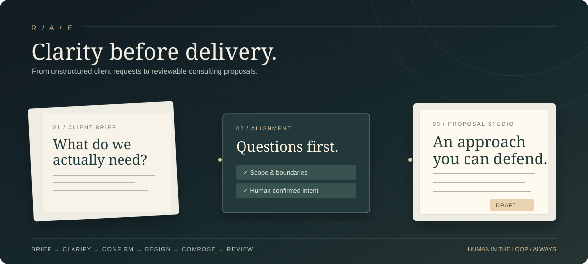

<div align="center">

<sub><b>REQUIREMENT ALIGNMENT ENGINE</b> &nbsp; / &nbsp; THE CONSULTING WORKSPACE</sub>

<br/><br/>

# The distance between<br/>a brief and a breakthrough.

**把模糊的客户需求，转化为有依据、可确认、可审阅的咨询方案。**

*Turn ambiguous client briefs into aligned requirements, defensible approaches, and reviewable proposals.*

<br/>

[**Explore the Preview ↗**](https://requirement-alignment-engine-git-feat-consulting-77f2e5-yihan4.vercel.app) &nbsp;·&nbsp;
[**How it works ↓**](#the-journey) &nbsp;·&nbsp;
[**Run locally ↓**](#quick-start)

<br/>

[](https://github.com/ychen393/Requirement-Alignment-Engine/actions/workflows/consulting-ci.yml)


<br/>



</div>

<br/>

> [!IMPORTANT]
> **Development preview, not a client-delivery system.** The AI-assisted workflow is experimental. Proposals are marked **DRAFT**; real client material should not be uploaded until end-to-end authentication, access controls, evidence handling, and approval are verified. **DEMO** mode is a fixed benchmark fixture, *not* a general-purpose analyzer.

---

## The problem

Great consulting work rarely starts with a great brief.

A client says *“We need an AI marketing assistant.”* But what does *need* mean? Which channel comes first? What counts as a factual claim? Who signs off? How do we know the solution worked?

**A polished proposal built on an unverified assumption is still the wrong proposal.**

Requirement Alignment Engine introduces an explicit **clarify → confirm → propose** boundary between the first conversation and the final deliverable.

<table>
<tr><td width="50%"><b>✳ BEFORE / THE INPUT</b><br/><br/>“We want an AI assistant that writes better marketing copy.”<br/><br/><i>Ambiguous scope. Missing evidence. Undefined acceptance criteria.</i></td><td width="50%"><b>↗ AFTER / THE REVIEWABLE OUTPUT</b><br/><br/><b>V1 / Xiaohongshu copy assistant</b><br/>5 internal pilot users · 3 creative directions · claim-level evidence · human approval · ≥30% cycle-time reduction target.<br/><br/><i>Illustrative transformation of a sample brief, not a verified customer outcome.</i></td></tr>
</table>

## The journey

<div align="center">

**01 — Listen** &nbsp; → &nbsp; **02 — Question** &nbsp; → &nbsp; **03 — Agree**
<br/>
**04 — Design** &nbsp; → &nbsp; **05 — Compose** &nbsp; → &nbsp; **06 — Review**

</div>

| Act | What happens | What you get |
|:--|:--|:--|
| **01 · Client Brief** | Capture the original request without silently replacing its meaning | Source brief |
| **02 · Clarification** | Surface gaps, assumptions, constraints, risks, and unanswered questions | Clarification questions |
| **03 · Requirement V1** | Human reviews and explicitly confirms the scope | Versioned requirement |
| **04 · Consulting Approach** | Translate approved scope into workstreams, methods, inputs, and deliverables | Editable approach |
| **05 · Proposal Studio** | Compose a structured proposal from the confirmed requirement and approach | Editable proposal |
| **06 · Client Preview** | Render an HTML draft with an explicit delivery warning | **DRAFT** preview / HTML |

**The invariant:** A proposal must stay anchored to its own confirmed brief — never to a prior session's sample fixture.

<details>
<summary><b>See a realistic example · Marketing copy assistant</b></summary>

<br/>

**Client's initial request:** Build an AI marketing-copy assistant to reduce research, writing, revisions, and compliance review work.

**Questions to resolve:** What product facts may be used? Which brand guidelines are authoritative? Who approves the final draft? How is the ≥30% time saving measured?

**MVP boundary:** Xiaohongshu only; five internal users; three creative directions; revision tracking; product claims and promotional prices supported by supplied documents; ask before inventing missing facts.

**Expected proposal structure:** problem framing → objectives → evidence and content workflow → generation and review approach → pilot design → evaluation criteria → risks, assumptions, and open questions.

*Example of the intended product behavior, not a claim that live generation has passed acceptance testing.*

</details>

## Built around decisions, not just generation

<table>
<tr><td width="50%"><b>◇ Explicit confirmation</b><br/>A generated suggestion is not a stakeholder-approved requirement. Downstream steps reject unconfirmed inputs.</td><td width="50%"><b>◇ Traceability by design</b><br/>Proposal composition carries structured provenance concepts and draft markings; full evidence-backed RAG is still in progress.</td></tr>
<tr><td><b>◇ Change-aware foundation</b><br/>Requirement versions, change analysis, execution planning, and completion checks remain available in the domain/API foundation.</td><td><b>◇ Enterprise knowledge foundation</b><br/>Supabase PostgreSQL tables, RLS policies, pgvector, and a private storage bucket are provisioned in the development project; ingestion is not yet complete.</td></tr>
</table>

## Under the hood

```text
  CLIENT BRIEF                 HUMAN REVIEW
        │                           │
        ▼                           ▼
  Requirement analysis  ──►  Clarification / Alignment
                                      │ confirmed V1
                                      ▼
                               Consulting Approach
                                      │
                                      ▼
                                 Proposal Studio
                                      │
                                      ▼
                              HTML / DRAFT Preview

  Next.js UI     →     FastAPI + Pydantic     →     LLM provider
                                   │
                                   └─ Supabase Auth / PostgreSQL / pgvector
                                      (knowledge integration in progress)
```

| Layer | Technology | Responsibility |
|:--|:--|:--|
| Experience | **Next.js / TypeScript / React** | Brief intake, alignment, workstreams, proposal editor |
| API & contracts | **FastAPI / Pydantic / Python** | Validation, workflow boundaries, composition |
| AI | **OpenAI-compatible Chat Completions** | Structured requirement and approach generation; DeepSeek-compatible JSON mode supported |
| Knowledge foundation | **Supabase PostgreSQL / RLS / pgvector / private Storage** | Tenant-scoped documents, access grants, chunk schema |
| Delivery | **Vercel Preview + GitHub Actions** | Branch previews and automated checks |

### What exists — and what doesn't (yet)

| Capability | State |
|:--|:--|
| Client Brief → clarification → confirmed requirement | **Implemented** · real-model quality remains under validation |
| Consulting Approach → editable Proposal → HTML draft | **Implemented** · internal draft only |
| OpenAI-compatible / DeepSeek JSON-output adapter | **Implemented** · provider/runtime acceptance ongoing |
| Supabase schema, RLS, private storage provisioning | **Provisioned in DEV** |
| Auth read endpoint and initial login UI | **Prototype** · real login E2E not signed off |
| Multi-tenant RLS checks with synthetic identities | **Database-level tests performed** · browser/API E2E pending |
| Evidence retrieval, document ingestion, embeddings | **In progress / not yet wired end-to-end** |
| Server-authorized approval and client-ready export | **Not shipped** |

We intentionally distinguish **code committed**, **tests passing**, **deployed**, and **end-to-end validated**.

## Quick start

**Prerequisites:** Python 3.11+, Node.js, and npm.

```bash
git clone https://github.com/ychen393/Requirement-Alignment-Engine.git
cd Requirement-Alignment-Engine
git checkout feat/consulting-proposal-mvp
python -m pip install -e ".[dev]"
python -m pytest -q
```

**Terminal A · API**

```bash
export APP_MODE=DEMO
export FRONTEND_ORIGIN=http://localhost:3100
uvicorn requirement_alignment.api.main:app --reload --port 8100
```

**Terminal B · web experience**

```bash
cd frontend
npm ci
npm run dev
```

Open **http://localhost:3100**.

> [!WARNING]
> In **DEMO** mode, the analyzer is limited to its *canonical model-benchmark fixture*. Entering an unrelated real client brief is intentionally rejected rather than silently substituted. For arbitrary briefs, configure a real provider and set `APP_MODE=AI`.

<details>
<summary><b>Configure AI mode · server-side only</b></summary>

<br/>

```bash
export APP_MODE=AI
export LLM_BASE_URL=https://api.deepseek.com
export LLM_MODEL=deepseek-flash
export LLM_API_KEY="your-secret-key"
export LLM_TIMEOUT_SECONDS=60
```

These values must be exported in the **API server environment** before starting the server. DeepSeek uses `json_object` output in the adapter, then Pydantic validates the returned structure. Other providers may use strict JSON Schema format.

Never commit API keys, put them under `NEXT_PUBLIC_*`, or include real client secrets in demo inputs. See [`.env.example`](./.env.example) for configuration guidance.

</details>

<details>
<summary><b>API surface</b></summary>

<br/>

| Endpoint | Purpose |
|:--|:--|
| `GET /health` | Mode / configuration status |
| `POST /requirements/analyze` | Analyze an intake brief |
| `POST /requirements/align` | Draft aligned requirement |
| `POST /consulting/approach` | Suggest consulting workstreams |
| `POST /consulting/proposal` | Compose structured proposal |
| `POST /consulting/proposal/preview` | Render draft HTML |
| `POST /consulting/proposal/export` | Export DRAFT-only HTML |
| `GET /knowledge/documents` | Authenticated scoped knowledge read |
| `POST /plans/generate`, `/changes/analyze`, `/completion/evaluate` | Earlier workflow foundation |

</details>

## Road ahead

- [x] Contract-first requirement and proposal models
- [x] Human confirmation gates and HTML draft output
- [x] CI for backend and frontend
- [x] Supabase development schema and initial RLS validation
- [ ] Real-model end-to-end acceptance on diverse client briefs
- [ ] Full Auth/browser-to-API tenant isolation testing
- [ ] Secure document ingestion + retrieval with citations
- [ ] Persisted projects, audit logs, and server-enforced approval
- [ ] Client-ready export after authorization and review

---

<div align="center">

<sub>GOOD PROPOSALS AREN'T GENERATED FROM GUESSWORK.</sub>

### First, make sure we're solving the right problem.

<sub>Requirement Alignment Engine · An evolving consulting-workflow experiment.</sub>

[Open the development preview ↗](https://requirement-alignment-engine-git-feat-consulting-77f2e5-yihan4.vercel.app) &nbsp;·&nbsp; [Explore the code ↗](https://github.com/ychen393/Requirement-Alignment-Engine/tree/feat/consulting-proposal-mvp)

</div>
