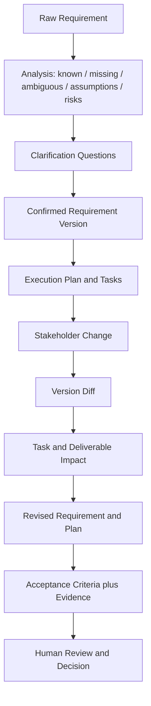

<p align="center">
  <h1 align="center">Requirement Alignment Engine</h1>
  <p align="center"><strong>Turn vague requests into confirmed, traceable, and verifiable execution plans.</strong></p>
  <p align="center">A human-in-the-loop requirements workspace for clarification, version control, task-impact analysis, and evidence-based delivery review.</p>
</p>

<p align="center"><a href="#demo-walkthrough">Demo</a> · <a href="#the-problem">The problem</a> · <a href="#workflow-and-domain-model">Workflow and model</a> · <a href="#system-architecture">Architecture</a> · <a href="#run-locally">Run locally</a> · <a href="README_ZH.md">简体中文</a></p>

> **Project direction:** AI Product × Requirements Engineering　**Current stage:** MVP　**Principle:** AI proposes; people confirm
>
> **Demo note:** The repository's end-to-end walkthrough uses deterministic fixtures and makes no live model calls. An AI provider is optional. Model names, datasets, and metrics below are illustrative fixture data, not results from a real model benchmark.

## Demo walkthrough

### From “test which model is good” to a scoped, measurable, reviewable plan

#### 1. Start with a vague request

```text
Test different models' capability scores and see which model is suitable for our business.
```

The direction is clear, but the request is not executable yet: it does not name candidate models, a capability, a dataset, a scoring rubric, or how to trade off quality, latency, and cost.

#### 2. Surface gaps, ambiguity, and risk

The demo analysis separates confirmed information, missing information, assumptions, ambiguities, and risks. Its example clarification gaps include:

| Question to resolve | Requirement field | Why it matters |
|---|---|---|
| Which candidate models should be tested? | `candidate_models` | Defines the comparison set and run scope |
| Which capability comes first? | `scope` | Defines the initial test boundary |
| Which dataset should be used? | `dataset` / `scope` | Determines whether results are reproducible and comparable |
| Is the first run generic or project-specific? | `scope` | These test different kinds of business validity |
| How is quality scored? | `metrics.quality` | Model outputs cannot be compared without a shared rubric |
| Does cost affect selection? | `metrics.cost` | Captures unit economics for a standard workload |
| Does latency affect selection? | `metrics.latency` | Determines suitability for interactive use cases |
| What deliverables are expected? | `expected_outputs` | Makes the expected result concrete |
| How is the final recommendation decided? | `acceptance_criteria` | Turns “looks suitable” into a checkable decision |

The fixture also records two ambiguities: **model capability** could mean a generic skill or performance in a specific project, and **suitable** has no defined trade-off between quality, latency, and cost. Its main risk is that results will not be comparable unless cases, prompts, runtime settings, and scoring are frozen.

#### 3. Answer questions and create Requirement V1

The example answers scope V1 as a generic Brief Understanding benchmark:

- **Candidates:** GPT-5, Claude Sonnet, Gemini Pro, and Doubao 1.5.
- **Test scope:** 100 frozen generic Brief Understanding cases; project-specific validation is out of scope for V1.
- **Quality:** Blind-score correctness, completeness, and instruction following; target pass rate is at least 80%.
- **Latency:** Compare end-to-end P95 from repeated runs in the same environment; target is at most 8 seconds.
- **Cost:** Calculate standard-workload token cost using recorded prices; target is at most USD 25 per million tokens.
- **Recommendation weights:** Quality 60%, latency 20%, cost 20%.
- **Deliverables:** Case-level results, model comparison, and an evidence-indexed recommendation report.

These values come from the repository's deterministic example fixture. They demonstrate how requirements can be made explicit; they are not results from an actual benchmark run.

#### 4. Receive a stakeholder change

```text
Doubao 1.5 is being retired, so stop testing it. Run the project test set next week, continue adding test cases, and do Final Validation for the Top 2.
```

The engine converts the change into an explicit V1 → V2 version diff. The example removes Doubao 1.5, adds a project test set, adds missing and boundary cases, requires Top 2 Final Validation, and changes the final recommendation criteria to use both generic and project evidence.

#### 5. Explain the impact on work already in progress

| Existing work or requirement | Impact analysis | Recommended treatment |
|---|---|---|
| Prepared generic test set | Still satisfies the generic-test requirement in V2 | Keep it; do not prepare it again |
| Completed generic benchmark | Existing generic results remain valid | Preserve the evidence; no full rerun solely because project tests were added |
| Candidate configuration | Doubao 1.5 is being retired | Disable that candidate and retain other configurations |
| Quality, P95 latency, normalized cost | The change does not alter comparison dimensions | Keep existing metrics and weights |
| Result comparison | Final recommendation now needs project evidence | Extend analysis after project results are available |
| Recommendation report draft | Project evidence and Top 2 validation are missing | Keep the draft; complete evidence before approval |
| Project tests and coverage additions | These were not part of V1 | Add project-case preparation, missing/boundary supplementation, and execution tasks |
| Top 2 final gate | A new decision gate was requested | Add Top 2 selection, independent validation, and business approval tasks |

The key is carrying a requirement change through to **metrics, tasks, dependencies, deliverables, and acceptance criteria**, while explaining what remains valid, what needs adjustment, and what is newly required. The fixture does not require completed outputs to be reworked from scratch.

#### 6. Check delivery status against evidence

V2 acceptance requires: the generic benchmark; traceable quality, latency, and cost results; a completed project benchmark; missing/boundary cases; Top 2 Final Validation; and an approved recommendation using both generic and project results.

In the fixture, evidence exists for the first two criteria. Project testing, coverage supplements, Top 2 validation, and final approval are still missing; the report is only a draft. The engine therefore returns **`PARTIALLY_COMPLETED`**, lists the unresolved work, and does not mark the report or project complete.

## The problem

Collaborative projects often start with a short request and change as stakeholders learn more. When changes live only in chat threads, teams struggle to answer:

- Which version is the current source of truth?
- Which completed work and future tasks are affected by a change?
- Which results can be reused, and which need adjustment or rework?
- Is there evidence that acceptance criteria were met, or was only a document completed?

Requirement Alignment Engine models these questions as versioned, linked, stateful workflow objects so changes can be explained and reviewed. It is a **requirements-alignment and decision-support tool**; it does not autonomously manage a project or make the final business decision.

## Workflow and domain model



### How the domain objects connect

| Object | What it records | Role in the workflow |
|---|---|---|
| `RawRequirement` | Original description, submitter, source, and workflow status | Preserves the initial request instead of overwriting it with later interpretation |
| `RequirementAnalysis` | Confirmed information, gaps, assumptions, ambiguities, and risks | Explains why a request may not yet be ready for execution |
| `ClarificationQuestion` | Question, target field, priority, answer, and respondent | Makes stakeholder answers traceable inputs |
| `RequirementVersion` | Objective, scope, exclusions, constraints, metrics, deliverables, acceptance criteria, and additional fields | Creates a reviewable snapshot that can be compared with later versions |
| `RequirementDiff` | Field path, change category, old/new values, and explanation | Shows exactly what changed between two versions |
| `ExecutionPlan` / `Task` | Task order, dependencies, effort estimate, status, requirement references, and deliverables | Converts confirmed requirements into execution work |
| `ImpactAnalysis` | Tasks to keep, modify, rework, or add, plus affected deliverables | Explains the operational effect of a requirement change |
| `CompletionEvaluation` | Criterion status, evidence references, explanation, and unresolved items | Checks whether delivery is supported by evidence and identifies what remains |

### Runtime states and confirmation boundary

Generated requirements, plans, change analyses, and completion reviews carry a `confirmation_status`. AI-created proposals return as **`AI_SUGGESTED`**. Endpoints that depend on an approved requirement or plan require the caller to explicitly submit it as **`USER_CONFIRMED`**. An unconfirmed proposal is rejected with a conflict response; it is never treated as user approval.

The runtime mode is explicit as well: `APP_MODE=DEMO` uses fixed fixture data; `APP_MODE=AI` uses the configured compatible model provider. If the mode is missing, configuration is incomplete, a request times out, the provider fails, or structured output fails domain validation, the API returns an explicit error. It does not silently switch modes or present fixture output as real AI output.

## System architecture

| Layer | Implementation | Responsibility |
|---|---|---|
| Domain model | Python, Pydantic | Define structured contracts for requirements, tasks, changes, acceptance, and confirmation status |
| Workflow services | `requirement_flow`, `change_flow`, `evaluation_flow` | Coordinate analysis, requirement alignment, planning, impact analysis, and completion evaluation |
| State management | Explicit workflow and confirmation states | Control valid transitions from clarification through proposal, confirmation, and review |
| AI provider | OpenAI-compatible Chat Completions + Structured Output | Produce JSON Schema-shaped proposals and validate them against domain contracts |
| API | FastAPI | Expose stateless request/response endpoints and explicit errors |
| Web UI | Next.js, React, TypeScript | Present requirements, diffs, tasks, and acceptance evidence in a document-centric interface |
| Tests and demo | pytest, deterministic fixtures | Reproduce the core workflow without live model calls |

The backend is stateless: workflow inputs and artifacts travel through API request/response payloads. The current frontend keeps working state in the browser session. The MVP has no database, account system, or cross-device persistence.

## Frontend routes

| Route | Page responsibility | What users review |
|---|---|---|
| `/` | Workspace | Workflow entry points and active runtime mode |
| `/new` | Requirement intake and analysis | Original request, known facts, gaps, ambiguity, risks, and questions |
| `/alignment` | Requirement version alignment | Structured objective, scope, metrics, deliverables, criteria, and version differences |
| `/execution` | Plan and change impact | Task status, dependencies, retained/modified/new work, and revised plan |
| `/review` | Delivery acceptance | Criterion status, evidence, missing items, and decisions awaiting a person |

The interface separates proposal from confirmation. Its main reading path follows a change from the stakeholder's text to a field-level diff, then to impacted tasks and the acceptance criteria those tasks support.

## API overview

| Method | Path | Purpose |
|---|---|---|
| `GET` | `/health` | Check service and runtime-mode configuration status |
| `POST` | `/requirements/analyze` | Analyze a raw request and generate clarification questions |
| `POST` | `/requirements/align` | Generate a structured requirement proposal from the request, analysis, and answers |
| `POST` | `/plans/generate` | Generate an execution-plan proposal from a confirmed requirement |
| `POST` | `/changes/analyze` | Return proposed version, diff, impact analysis, and revised plan for a stakeholder change |
| `POST` | `/completion/evaluate` | Propose an acceptance evaluation from confirmed requirements, plan, and evidence status |

An `AI_SUGGESTED` requirement or plan cannot be passed downstream as if confirmed. The caller must submit a `USER_CONFIRMED` object after human review.

## Run locally

Requires Python 3.11+ and Node.js for the frontend.

### 1. Install the Python package and run the deterministic workflow

```bash
python -m pip install -e ".[dev]"
python demo.py
```

The CLI prints the raw request, detected information gaps, clarification answers, Requirement V1, stakeholder change, V1→V2 diff, task impact, revised execution plan, and completion status. It requires no API key and makes no live model calls.

### 2. Start the backend API (PowerShell, DEMO mode)

```powershell
python -m pip install -e ".[dev]"
$env:APP_MODE = "DEMO"
$env:FRONTEND_ORIGIN = "http://localhost:3100"
uvicorn requirement_alignment.api.main:app --reload --port 8100
```

### 3. Start the frontend

```powershell
cd frontend
Copy-Item .env.local.example .env.local
npm.cmd install
npm.cmd run dev
```

Open `http://localhost:3100`. Requirement Alignment Engine uses port 3100; AgentLab uses port 3000.

### 4. Optional: configure AI mode

The provider must support `/chat/completions` and JSON Schema Structured Output. Configure credentials in the environment; do not commit them:

```powershell
$env:APP_MODE = "AI"
$env:LLM_BASE_URL = "https://your-provider.example/v1"
$env:LLM_API_KEY = "your-api-key"
$env:LLM_MODEL = "your-model-name"
$env:LLM_TIMEOUT_SECONDS = "30"
uvicorn requirement_alignment.api.main:app --reload --port 8100
```

The repository includes `.env.example` for variable names, but the app does not load it automatically. Set variables in your shell or deployment platform. For live-provider runs, record provider, model, input version, and outputs separately from deterministic demo results.

## Validation

```bash
python -m pip install -e ".[dev]"
python -m pytest
python demo.py
python smoke.py --mode DEMO
```

Default tests and the demo use deterministic logic and need no credentials. `smoke.py --mode AI` calls the configured external provider; run it only when you intend to validate that integration. Its output depends on provider configuration and model responses.

## Scope and next steps

This is a single-user, database-free MVP focused on structured requirements, change-impact analysis, and human-reviewed acceptance. It does not include authentication, long-term project storage, a task-execution engine, automatic deployment, or unsupervised project decisions.

Potential extensions include durable version/evidence storage, multi-user collaboration and approval history, integrations with task-management tools, and additional domain-specific requirement and acceptance templates. Any real-model capability should be validated separately with a reproducible provider-level evaluation.

---

<p align="center"><sub>Requirement Alignment Engine · Make changing requirements reviewable and actionable</sub></p>
