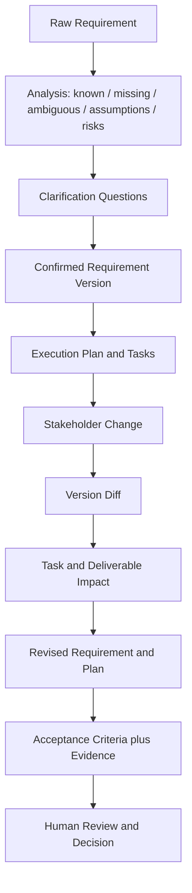

<p align="center">
  <h1 align="center">Requirement Alignment Engine</h1>
  <p align="center"><strong>把模糊需求变成可确认、可追踪、可验收的执行依据。</strong></p>
  <p align="center">一个 Human-in-the-loop 需求对齐工作台：从需求澄清、版本管理和任务影响分析，到基于证据的交付验收。</p>
</p>

<p align="center"><a href="#项目演示">项目演示</a> · <a href="#它解决的问题">解决的问题</a> · <a href="#工作流与领域模型">工作流与领域模型</a> · <a href="#系统架构">系统架构</a> · <a href="#本地运行">本地运行</a> · <a href="README.md">English</a></p>

> **项目方向：** AI Product × Requirements Engineering　**当前版本：** MVP　**设计原则：** AI 提议，人来确认
>
> **演示说明：** 本仓库的完整演示由确定性 fixture 数据驱动，不依赖在线模型。AI Provider 是可选接入能力；文中的模型、数据集与指标只是演示项目，不代表真实模型评测结果。

## 项目演示

### 从“测一下哪个模型好”，到有边界、有指标、能验收的计划

#### 1. 输入一条模糊的初始需求

```text
测试不同模型的能力评分，看看哪个模型比较适合我们的业务。
```

这句话说明了大方向，却无法直接指导执行：没有候选模型、测试能力、数据集、评分标准，也没有定义“适合”如何权衡质量、速度和成本。

#### 2. 找出缺口、歧义和风险

Demo 分析会把需求拆成已知信息、缺失信息、歧义、假设与风险。示例中的缺口包括：

| 需要澄清的内容 | 对应需求字段 | 为什么影响执行 |
|---|---|---|
| 候选模型有哪些？ | `candidate_models` | 决定运行范围和比较对象 |
| 第一阶段优先测哪项能力？ | `scope` | 决定测试集边界 |
| 使用哪份数据集？ | `dataset` / `scope` | 关系到结果能否复现和横向比较 |
| 做通用测试还是项目测试？ | `scope` | 两者代表不同的业务外部有效性 |
| 质量按什么 rubric 评分？ | `metrics.quality` | 没有统一口径就无法比较输出质量 |
| 是否把调用成本纳入选型？ | `metrics.cost` | 影响部署后的单位任务成本 |
| 是否把响应延迟纳入选型？ | `metrics.latency` | 影响用户体验和交互场景适配 |
| 最终需要交付什么？ | `expected_outputs` | 明确结果应形成数据、报告还是其他产物 |
| 如何作出最终推荐？ | `acceptance_criteria` | 将“看起来不错”变成可检查的判断条件 |

Demo 还指出两类核心歧义：**模型能力**可能指通用能力，也可能指具体项目表现；**适合**没有定义质量、延迟和成本之间的取舍。主要风险是若不冻结测试用例、Prompt、运行设置和评分规则，各模型结果将不可比。

#### 3. 通过澄清回答生成 Requirement V1

示例回答将第一阶段限定为通用 Brief Understanding 评测：

- **候选模型：** GPT-5、Claude Sonnet、Gemini Pro、Doubao 1.5。
- **测试范围：** 100 条冻结的通用 Brief Understanding 用例；项目专属验证暂不纳入 V1。
- **质量口径：** 盲评正确性、完整性和指令遵循情况，目标通过率至少 80%。
- **延迟口径：** 在相同环境重复运行，比较端到端 P95，目标不高于 8 秒。
- **成本口径：** 按 Token 用量与记录价格计算标准工作量成本，目标不高于每百万 Token 25 美元。
- **推荐权重：** 质量 60%、延迟 20%、成本 20%。
- **交付物：** 用例级结果、模型比较和带证据索引的推荐报告。

这些数字来自仓库中的演示 fixture，用于展示结构化需求的表达方式，不是一次真实 Benchmark 的运行结果。

#### 4. 利益相关方提出新变更

```text
豆包 1.5 快下架了，不需要继续测试。下周跑项目测试集并继续补充测试集，最后对 Top 2 做 Final Validation。
```

引擎把自然语言变更转换为显式的 V1 → V2 版本差异。示例中的变更包括：移除 Doubao 1.5；新增项目测试集；补充缺失与边界用例；对 Top 2 执行 Final Validation；把最终推荐条件改为同时使用通用和项目结果。

#### 5. 解释变更会怎样影响现有工作

| 现有工作 / 需求项 | 影响分析 | 建议处理 |
|---|---|---|
| 已准备的通用测试集 | 仍符合 V2 的通用测试要求 | 保留，不重复准备 |
| 已运行的通用 Benchmark | 原始通用结果仍有效 | 保留证据，不因新增项目测试而整批重跑 |
| 候选模型配置 | Doubao 1.5 即将下架 | 禁用该候选，保留其他配置 |
| 质量、P95 延迟、归一化成本 | 变更没有修改评价维度 | 沿用原指标与权重 |
| 结果比较 | 最终结论需要项目数据 | 等项目测试完成后扩展比较 |
| 推荐报告草稿 | 缺少项目结果和 Top 2 验证 | 保留草稿，补齐证据后再批准 |
| 项目测试与覆盖补充 | V1 原计划中没有这些工作 | 新增项目用例准备、缺失/边界用例补充和执行任务 |
| Top 2 终验 | 新增最终决策门槛 | 新增 Top 2 选择、独立验证和业务批准任务 |

核心价值是将“需求改了”继续往下追踪到**指标、任务、依赖关系、交付物和验收条件**，同时解释哪些既有工作还有效、哪些需要调整、哪些工作是新增的。Demo 中没有已完成产物需要整体返工。

#### 6. 检查交付状态，而不是只看报告是否写完

V2 的验收标准要求：通用测试完成；质量、延迟和成本结果可追溯；项目测试完成；缺失与边界用例补充完成；Top 2 Final Validation 完成；推荐报告纳入通用与项目结果并获批准。

在仓库 fixture 中，前两项已有证据；项目测试、覆盖补充、Top 2 终验和最终审批仍缺少证据，报告只有草稿。因此系统返回 **`PARTIALLY_COMPLETED`**，并列出下一步待办，而不会将报告或整个项目误标为完成。

## 它解决的问题

在多方协作的项目里，初始需求往往很短，执行中又会调整范围、候选对象和验收要求。若变化只存在于聊天记录中，团队很难判断：

- 哪个版本才是当前依据？
- 需求变化影响了哪些已完成工作和后续任务？
- 哪些结果仍可复用，哪些需要调整或重做？
- “完成”是否有满足标准的证据，还是只完成了文档？

Requirement Alignment Engine 将这些问题建模为带版本、关系和状态的工作流对象，使需求变化可以被解释和审核。它是**需求对齐与决策支持工具**，不自动管理项目，也不代替业务负责人作最终决定。

## 工作流与领域模型



### 关键对象如何衔接

| 对象 | 记录内容 | 在流程中的作用 |
|---|---|---|
| `RawRequirement` | 原始描述、提交人、来源和工作流状态 | 保存需求最初的表达，不用后续整理覆盖原文 |
| `RequirementAnalysis` | 已确认信息、缺失信息、假设、歧义、风险 | 解释当前为什么还不能直接执行 |
| `ClarificationQuestion` | 问题、目标字段、优先级、回答人和答案 | 将口头澄清转成可追溯输入 |
| `RequirementVersion` | 目标、范围、排除项、约束、指标、交付物、验收标准及扩展字段 | 形成可比较、可确认的需求快照 |
| `RequirementDiff` | 字段路径、变化类型、前后值及说明 | 解释两个版本之间究竟改变了什么 |
| `ExecutionPlan` / `Task` | 任务顺序、依赖、工时估计、状态、需求引用和交付物 | 把确认过的需求转成执行工作 |
| `ImpactAnalysis` | 保留、调整、返工、新增任务及受影响交付物 | 判断变化对现有工作的具体影响 |
| `CompletionEvaluation` | 验收项状态、证据引用、解释和未解决项 | 判断交付是否有证据支持，并说明还差什么 |

### 运行状态与确认边界

生成的需求、计划、变更分析和验收建议都带有 `confirmation_status`。AI 创建的建议以 **`AI_SUGGESTED`** 返回；依赖已确认需求或计划的接口要求请求显式提供 **`USER_CONFIRMED`** 对象。未确认时 API 返回冲突错误，不会默认为用户同意。

应用运行模式也必须明确：`APP_MODE=DEMO` 使用固定演示数据；`APP_MODE=AI` 使用已配置的兼容模型 Provider。没有设置模式、模型配置缺失、超时、Provider 错误或返回结构不符合领域 Schema 时，API 返回明确错误；不会静默切换到另一模式或用 Demo 结果伪装真实 AI 输出。

## 系统架构

| 层 | 实现 | 职责 |
|---|---|---|
| 领域模型 | Python、Pydantic | 表达需求版本、任务、变更、验收和确认状态等结构化契约 |
| 服务层 | `requirement_flow`、`change_flow`、`evaluation_flow` | 组织需求分析、版本对齐、计划生成、变更影响和完成度评估 |
| 状态管理 | 显式 workflow state 与确认状态 | 控制需求从澄清、建议、确认到评审的合法转换 |
| AI Provider | OpenAI-compatible Chat Completions + Structured Output | 生成符合 JSON Schema 的提议，并通过领域模型校验 |
| API | FastAPI | 提供无状态请求/响应接口和明确的错误状态 |
| Web UI | Next.js、React、TypeScript | 以文档为中心呈现需求、差异、任务和验收信息 |
| 测试与演示 | pytest、确定性 fixtures | 在不调用在线模型的情况下复现核心业务流程 |

后端无状态：工作流输入和产物通过 API 请求/响应传递。当前前端把工作状态保存在浏览器会话中；MVP 没有数据库、账号系统或跨设备持久化。

## 前端页面

| 路由 | 页面职责 | 用户重点检查什么 |
|---|---|---|
| `/` | 工作台 | 当前流程入口与运行模式 |
| `/new` | 新建需求与分析 | 原始描述、已知信息、缺口、歧义、风险和澄清问题 |
| `/alignment` | 需求版本对齐 | 结构化目标、范围、指标、交付物、验收项和版本差异 |
| `/execution` | 执行计划与变更影响 | 任务状态、依赖、保留/调整/新增工作和计划更新 |
| `/review` | 交付验收 | 每项验收状态、证据、缺失项和待人工决定事项 |

界面将“建议”与“确认”作为不同状态呈现，核心阅读路径是从变更原文进入字段 Diff，再查看受影响任务和对应的验收要求。

## API 概览

| 方法 | 路径 | 用途 |
|---|---|---|
| `GET` | `/health` | 检查服务与当前模式配置状态 |
| `POST` | `/requirements/analyze` | 分析原始需求并生成澄清问题 |
| `POST` | `/requirements/align` | 根据原始需求、分析和澄清答案生成结构化需求提议 |
| `POST` | `/plans/generate` | 根据已确认需求生成执行计划提议 |
| `POST` | `/changes/analyze` | 分析利益相关方变更，返回版本、Diff、影响和修订计划提议 |
| `POST` | `/completion/evaluate` | 根据已确认需求、计划和证据状态生成验收评估提议 |

`AI_SUGGESTED` 输入不能直接作为依赖需求或计划的已确认输入；调用方应在人工确认后提交状态为 `USER_CONFIRMED` 的对象。

## 本地运行

需要 Python 3.11+ 和 Node.js（运行前端）。

### 1. 安装 Python 项目依赖并运行确定性流程

```bash
python -m pip install -e ".[dev]"
python demo.py
```

CLI 会输出原始需求、检测到的信息缺口、澄清问答、Requirement V1、利益相关方变更、V1→V2 Diff、任务影响、更新后的执行计划和完成状态。该命令不需要 API Key，也不发起在线模型调用。

### 2. 启动后端 API（PowerShell，DEMO 模式）

```powershell
python -m pip install -e ".[dev]"
$env:APP_MODE = "DEMO"
$env:FRONTEND_ORIGIN = "http://localhost:3100"
uvicorn requirement_alignment.api.main:app --reload --port 8100
```

### 3. 启动前端

```powershell
cd frontend
Copy-Item .env.local.example .env.local
npm.cmd install
npm.cmd run dev
```

访问 `http://localhost:3100`。Requirement Alignment Engine 使用 3100 端口；AgentLab 前端使用 3000 端口。

### 4. 可选：配置 AI 模式

Provider 需要兼容 `/chat/completions`，并支持 JSON Schema Structured Output。通过环境变量配置，不要把真实凭证写入仓库：

```powershell
$env:APP_MODE = "AI"
$env:LLM_BASE_URL = "https://your-provider.example/v1"
$env:LLM_API_KEY = "your-api-key"
$env:LLM_MODEL = "your-model-name"
$env:LLM_TIMEOUT_SECONDS = "30"
uvicorn requirement_alignment.api.main:app --reload --port 8100
```

仓库提供 `.env.example` 作为变量名参考，但应用不会自动加载该文件。请在 Shell 或部署平台中设置变量。若调用真实 Provider，请分别记录 Provider、模型、输入版本和结果，避免将其与固定 Demo 结果混为一谈。

## 验证方式

```bash
python -m pip install -e ".[dev]"
python -m pytest
python demo.py
python smoke.py --mode DEMO
```

默认测试与 Demo 使用确定性逻辑，不需要 API 凭证。`smoke.py --mode AI` 会调用已配置的真实 Provider，只有明确需要检查外部接入时再运行；其结果取决于 Provider 配置和模型输出。

## 项目边界与后续方向

当前是单用户、无数据库的 MVP，重点验证需求结构化、变更影响分析和人工验收机制。当前不包含认证、长期项目存储、任务执行引擎、自动部署或无人监督的项目决策。

后续可在保持确认边界的前提下扩展：持久化版本与证据、多人协作和审批记录、对接任务管理工具，以及建立更多领域的需求/验收模板。真实模型支持应通过可复现的 Provider 级验收单独验证。

---

<p align="center"><sub>Requirement Alignment Engine · Make changing requirements reviewable and actionable</sub></p>
